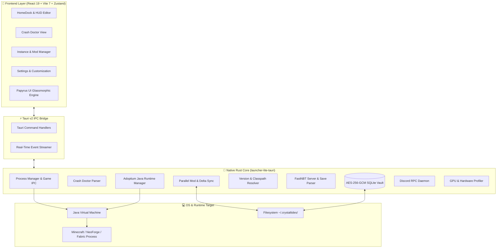

<p align="center">
  
</p>

<h1 align="center">🌊 CrystalTides Launcher Lite 💎</h1>

<p align="center">
  <strong>The Ultra-Lightweight, Next-Gen Minecraft Launcher & Runtime Orchestrator</strong><br/>
  <i>Engineered with Rust, Tauri v2, React 19 & Papyrus UI • Blazing Fast (<60MB RAM) • Native Crash Doctor AI</i>
</p>

<p align="center">
  <a href="https://github.com/UltraXn/crystaltides-launcher-lite/releases"></a>
  <a href="https://tauri.app/"></a>
  <a href="https://www.rust-lang.org/"></a>
  <a href="https://react.dev/"></a>
  <a href="https://vite.dev/"></a>
  <a href="https://discord.gg/crystaltides"></a>
</p>

---

## ⚡ Overview

**CrystalTides Launcher Lite** is a high-performance, minimalist desktop client crafted specifically for the **CrystalTides SMP** network and modern modded Minecraft gameplay. 

Replacing bulky Electron-based launchers that consume 400MB–800MB of idle memory, **Launcher Lite** harnesses **Tauri v2** and **Rust** to deliver sub-millisecond IPC response times, minimal disk overhead, and an idle memory footprint under **60 MB RAM**.

It features the proprietary **Papyrus UI Engine**—an interactive glassmorphic interface with a fully customizable HUD, collision-avoiding dock controls, live panoramic video backgrounds, automated Java orchestration, delta-patching mod updates, and built-in **Crash Doctor** diagnostics.

---

## ✨ Key Features Highlights

| Feature | Description |
| :--- | :--- |
| 🦀 **Rust Core Engine** | Powered by **Tauri v2** with non-blocking async process lifecycle management, strict path sandboxing, and sub-millisecond IPC communication. |
| 🎨 **Papyrus UI (v1.2.0)** | Glassmorphic design system featuring **interactive HUD Editor Mode**, drag-and-drop dock repositioning, dynamic collision dodging, and split-screen panoramic media. |
| 🩺 **Crash Doctor AI** | Automated stack trace analysis that pinpoints offending mods, offers one-click isolation/disabling, options.txt reset, and Out-of-Memory (OOM) recovery. |
| 📦 **Smart Dual-Boot Binary** | A single executable acts as a **Smart Self-Installer**, **Portable Client** (`--portable`), or **Clean Uninstaller** (`--uninstall`) with Windows Defender auto-exclusions. |
| 🔄 **Delta Patching & Fast Sync** | High-speed multi-threaded mod synchronization featuring **qbsdiff binary delta-patches** to minimize download sizes when updating modpacks. |
| ☕ **Intelligent Java Manager** | Automatic detection and 1-click provisioning of Adoptium / Temurin OpenJDK (8, 17, 21) tailored to the exact system architecture (x64 / ARM64). |
| 🎮 **Multi-Loader & Multi-Instance** | Native support for **NeoForge**, **Forge**, **Fabric**, **Quilt**, and vanilla Minecraft. Includes an importer for CurseForge, Modrinth, Prism, and MultiMC. |
| 🔐 **Hardware-Encrypted Vault** | Secure credentials storage using **AES-256-GCM** with SQLite (`rusqlite`), native Microsoft OAuth 2.0 PKCE authentication, and offline guest mode. |
| 🎯 **Hardware & GPU Presets** | Automatic GPU profiling (NVIDIA, AMD, Intel) injecting optimized driver flags (`__GL_THREADED_OPTIMIZATIONS`, DXVK/Vulkan tweaks, custom JVM args). |
| 🎧 **Discord Rich Presence** | Dynamic Discord status showcasing active Minecraft version, modpack name, elapsed session time, and in-game server telemetry. |

---

## 🏗️ Architecture Overview



---

## 🚀 Getting Started

### Prerequisites

Ensure you have the following installed on your development machine:

- **Node.js**: `v20.0.0+` or `v22.0.0+` (Node 24 supported)
- **pnpm** (recommended) or **npm**
- **Rust Toolchain**: `stable` (MSRV 1.78+) via [rustup.rs](https://rustup.rs/)
- **C++ Build Tools**:
  - **Windows**: Visual Studio C++ Build Tools (MSVC)
  - **Linux**: `build-essential`, `libwebkit2gtk-4.1-dev`, `libssl-dev`, `libayatana-appindicator3-dev`
  - **macOS**: Xcode Command Line Tools

---

### 📥 Installation & Local Development

1. **Clone the repository:**
   ```bash
   git clone https://github.com/UltraXn/crystaltides-launcher-lite.git
   cd crystaltides-launcher-lite
   ```

2. **Install frontend dependencies:**
   ```bash
   pnpm install
   # or: npm install
   ```

3. **Start the development server with Hot Reload:**
   ```bash
   # Starts Vite + Tauri v2 native development window
   pnpm dev:tauri
   # or: npm run dev:tauri
   ```

   *If you only want to preview the React frontend in your browser:*
   ```bash
   pnpm dev
   ```

---

## 📦 Production Packaging & Distribution

CrystalTides Launcher Lite includes an automated packaging pipeline via [`scripts/package.mjs`](scripts/package.mjs):

```bash
pnpm package
# or: npm run package
```

This compiles the release binary and produces the distribution artifacts in `dist-package/`:
- `CrystalTides-Setup.exe`: Smart self-installing wizard with shortcut creation and desktop integration.
- `CrystalTides-Portable.exe`: Zero-install, fully self-contained portable executable.
- `CrystalTides-Setup.exe.sig` + `latest.json`: Signed AutoUpdater manifest (when `crystaltides.key` / `TAURI_SIGNING_PRIVATE_KEY` is available).
- `SHA256SUMS.txt`: Cryptographic checksums for deployment verification.

There is **no NSIS/MSI bundle** (`bundle.active: false`): the launcher binary is its own installer, Discord-style.
Both `.exe` files are the same binary; the mode is chosen at startup:

| Mode | Trigger | Behaviour |
| :--- | :--- | :--- |
| Install | File name contains `setup`/`install`, `--install`, or not installed yet | Custom installer UI → copies itself to `~/.crystaltides/bin/CrystalTidesLauncher.exe`, creates shortcuts, registers in *Installed apps* (per-user, no admin) |
| Update | `/UPDATE` (passed by `tauri-plugin-updater`) or `--update` | Before any window is created, replaces `bin/CrystalTidesLauncher.exe` (staged copy + atomic rename, retried while the old process exits), bumps `.installed.json` and relaunches (`src-tauri/src/self_update.rs`) |
| Portable | File name contains `portable` or `--portable` | Runs without installing |
| Launcher | Running the installed binary | Normal launcher UI |

**Releases:** push a `vX.Y.Z` tag. The workflow fails unless the tag matches `version` in both `tauri.conf.json` and `Cargo.toml`, because the updater compares the compiled version against `latest.json`.

---

## 🕹️ CLI Execution Flags

The compiled binary supports automated operational flags:

```bash
# Launch normal launcher UI (default)
CrystalTidesLauncher.exe

# Run in portable mode (keeps all data local to current directory)
CrystalTidesLauncher.exe --portable   # (or -p)

# Launch the interactive installation wizard
CrystalTidesLauncher.exe --install    # (or -i)

# Launch the clean uninstallation wizard
CrystalTidesLauncher.exe --uninstall  # (or -u)

# Replace the installed binary with this one and relaunch (used by the AutoUpdater as /UPDATE)
CrystalTides-Setup.exe --update
```

---

## 🧪 Testing & Code Quality

We uphold strict quality standards with concentric linting and testing pipelines:

```bash
# Run unit and integration tests (Vitest)
pnpm test

# Generate test coverage report
pnpm test:coverage

# Ultra-fast AST linting with Oxlint
pnpm lint:fast

# Static TypeScript type check
pnpm lint

# Execute React Doctor code health audit
pnpm doctor

# Rust Clippy linting
pnpm lint:rust

# Cargo dependency security audit
pnpm deny:rust
```

---

## 📂 Project Structure

```
crystaltides-launcher-lite/
├── .github/                  # CI/CD Workflows (Release, Quality Gates)
├── public/                   # Static assets, wallpapers, modloader icons
│   ├── icons/                # Fabric, Forge, NeoForge, Quilt logos
│   ├── wallpapers/           # Official day/night high-res backgrounds
│   └── logo.png              # High-resolution brand logo
├── scripts/
│   └── package.mjs           # Native compilation & artifact packager
├── src/                      # React 19 Frontend (Papyrus UI)
│   ├── assets/               # Local bundled styles and vectors
│   ├── components/           # UI components, modals, and HUD overlays
│   │   ├── common/           # AmbientBubbles, CustomSelect, ErrorBoundary
│   │   ├── hud/              # HUD Editor controls and drag handles
│   │   ├── installer/        # Embedded installation screen
│   │   ├── modals/           # Settings, Instances, Accounts, About, Logs
│   │   └── uninstaller/      # Embedded uninstallation screen
│   ├── i18n/                 # Spanish (ES) & English (EN) translations
│   ├── modules/              # Extensible Launcher modules & Registry
│   ├── services/             # Tauri IPC bridge client services
│   ├── store/                # Zustand global state management
│   ├── utils/                # Collision math, path utilities, formatters
│   ├── App.tsx               # Main window layout and modal routing
│   └── index.css             # Papyrus glassmorphism & Tailwind design system
├── src-tauri/                # Rust Native Backend (Tauri v2)
│   ├── src/
│   │   ├── agent.rs          # Optimization Agent & Game IPC socket
│   │   ├── crash_doctor.rs   # Crash log analysis & offending mod detector
│   │   ├── db.rs             # SQLite profiles & credentials vault
│   │   ├── delta_patch.rs    # qbsdiff binary delta patch application
│   │   ├── discord_rpc.rs    # Discord Rich Presence integration
│   │   ├── gpu_preset.rs     # GPU profile & driver optimization engine
│   │   ├── hardware.rs       # System hardware telemetry (sysinfo)
│   │   ├── importer.rs       # External instance scanner & importer
│   │   ├── java_manager.rs   # Adoptium OpenJDK auto-installer
│   │   ├── mod_sync.rs       # Multi-threaded mod downloader & hashing
│   │   ├── nbt_manager.rs    # FastNBT world and server parser
│   │   ├── process_manager.rs# Game lifecycle & priority orchestrator
│   │   ├── version_manager.rs# Mojang & loader version manifest resolver
│   │   └── lib.rs            # Main Tauri command registry & startup flow
│   ├── Cargo.toml            # Rust dependencies & metadata
│   └── tauri.conf.json       # Tauri v2 configuration, window setup & CSP
├── package.json              # NPM scripts and frontend dependencies
├── tsconfig.json             # TypeScript compiler options
└── vite.config.ts            # Vite 7 + SWC compiler configuration
```

---

## 🔒 Security & Privacy

- **No Plaintext Passwords**: Credentials are encrypted locally via an isolated AES-256-GCM SQLite vault.
- **Official Microsoft OAuth 2.0 PKCE**: Passwords are never seen or stored by the client; authentication is completed directly through Microsoft's secure OAuth flow.
- **Sandboxed File Operations**: All file manipulations are validated against safe directory boundaries to prevent path traversal vulnerabilities.
- **Signed OTA Updates**: Binary auto-updates are cryptographically verified using Minisign public keys before execution.

---

## 🌐 Community & Support

- 💬 **Discord**: [Join CrystalTides Discord](https://discord.gg/crystaltides)
- 🌐 **Official Website**: [crystaltidessmp.net](https://crystaltidessmp.net)
- 🐛 **Report a Bug**: [GitHub Issues](https://github.com/UltraXn/crystaltides-launcher-lite/issues) or [Support Portal](https://crystaltidessmp.net/support)

---

## 📜 License

This project is licensed under the **MIT License** — see the [LICENSE](LICENSE) file for details.

<p align="center">
  <sub>Forged with 💙 by <strong><a href="https://github.com/UltraXn">UltraXn</a></strong> & the CrystalTides Engineering Team.</sub><br/>
  <sub><i>Not an official Minecraft product. Not approved by or associated with Mojang or Microsoft.</i></sub>
</p>
