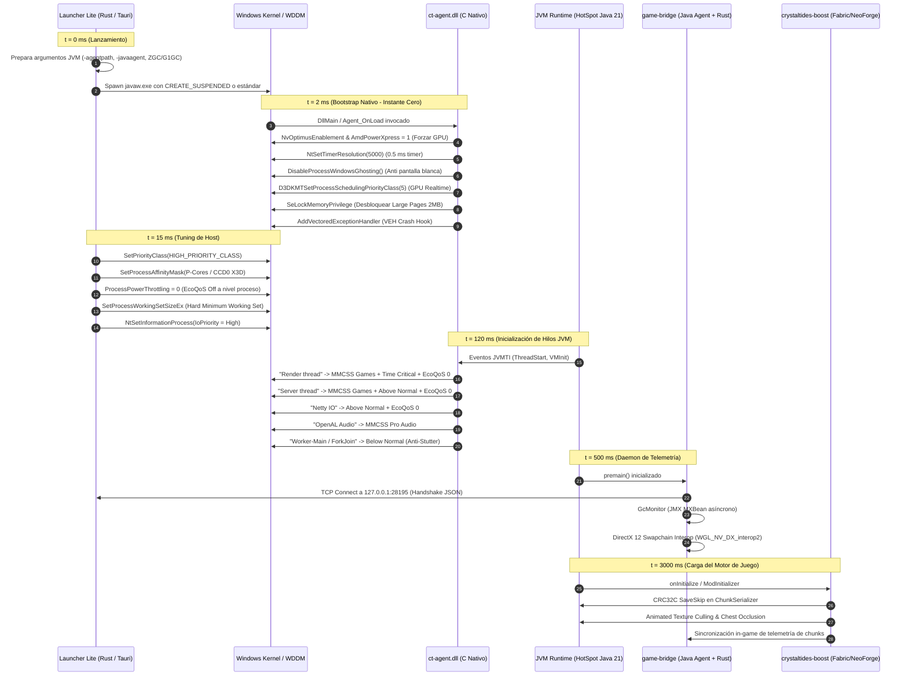

# 🏛️ Plan Maestro de Integración de Rendimiento: CrystalTides Ecosystem

> **Componentes Evaluados:**  
> 1. `apps/launcher-lite/src-tauri` (Orquestador de Sistema Operativo & Kernel en Rust)  
> 2. `apps/game-bridge` (Daemon de Hardware, Telemetría IPC & DirectX 12 Interop)  
> 3. `mods/crystaltides-boost` (Mod Multiloader de Optimización de Motor en Java)  
> 4. `apps/launcher-lite/native/ct-agent/ct_agent.c` (Micro-Agente Nativo JVMTI en C)  
>
> **Objetivo:** Establecer la arquitectura de producción definitiva, eliminando duplicidades y asignando a cada componente su responsabilidad exacta.

---

## 🗺️ Mapa de Arquitectura Unificada

```mermaid
graph TD
    subgraph CAPA 0: Sistema Operativo & Hardware (Host)
        L_WIN[launcher-lite: Win32 Kernel Tuning]
        L_WIN -->|P-Core Affinity| HW_CPU[CPU Intel/AMD]
        L_WIN -->|WorkingSet Hard Min| HW_RAM[RAM Física Anti-Paging]
        L_WIN -->|ProcessIoPriority High| HW_SSD[SSD/NVMe Disk I/O]
        L_WIN -->|TCP Server :28195| L_IPC[GameIPC Hub en Tauri]
    end

    subgraph CAPA 1: Bootstrap & Inyección Temprana de JVM
        L_WIN -->|Lanza javaw.exe con -agentpath| C_AGENT[ct_agent.dll / Early C Hook]
        C_AGENT -->|AvSetMmThreadCharacteristicsW| MMCSS[Windows Games Scheduler]
        C_AGENT -->|timeBeginPeriod 1ms| TIMER[Temporizador de Alta Resolución]
        C_AGENT -->|-Dorg.lwjgl.system.allocator| ALLOC[mimalloc / jemalloc Native Allocator]
    end

    subgraph CAPA 2: Runtime de Minecraft (In-Process javaw.exe)
        subgraph Hardware & Telemetry Bridge (apps/game-bridge)
            GB_JVM[CrystalAgent - Java Agent]
            GB_RUST[game_bridge_core.dll - Rust Core]
            GB_TELE[GcMonitor & IpcClient]
            GB_GPU[WGL_NV_DX_interop2 & Instant Replay]
        end

        subgraph Engine & Gameplay Optimizations (mods/crystaltides-boost)
            CB_CHUNK[SaveSkip: CRC32C Autosaves]
            CB_CULL[ChestOcclusion & AnimatedTextureCulling]
            CB_THREAD[Prioridad de Hilos en JVM: Render vs Workers]
        end
    end

    GB_TELE -->|TCP Stream en Vivo| L_IPC
    GB_RUST <-->|Zero-Copy Textures en VRAM| GB_GPU
    CB_CHUNK -.->|Convive de forma limpia en el Engine| GB_JVM
```

---

---

## ⏱️ Timeline de Microsegundos: Secuencia de Inicialización

El siguiente diagrama detalla la orquestación temporal de arranque, garantizando que cada capa actúe en el instante óptimo sin colisiones:



---

## 📋 Matriz de Responsabilidades y Delimitación de Capas

| Componente | Capa de Ejecución | Lenguaje | Responsabilidad Exclusiva | Qué NO debe hacer |
| :--- | :--- | :--- | :--- | :--- |
| **`launcher-lite/src-tauri`** | Proceso Padre (Host) | Rust | • Kernel tuning (Afinidad P-cores, WorkingSet hard min, I/O Priority).<br>• Servidor TCP local (`:28195`).<br>• Detección y descarga de runtimes Java (GraalVM / Temurin).<br>• Gestión de argumentos de JVM (`-agentpath`, GC flags). | No debe tocar el bytecode de Minecraft ni intentar renderizar dentro del juego. |
| **`ct_agent.c` (Micro-Agente C)** | Instante 0 de JVM (`-agentpath`) | C Puro | • Inscribir hilos en **"Games"** y **"Pro Audio"** de MMCSS.<br>• Fijar temporizador kernel a 0.5 ms.<br>• Forzar GPU dedicada para NVIDIA y AMD.<br>• Vehicular captura forense nativa (VEH) y Large Pages.<br>• Exponer JNI para purga de `mimalloc`. | No debe contener lógica de negocio, sockets TCP pesados ni interfaces gráficas. |
| **`apps/game-bridge`** | In-Process (`javaw.exe`) | Java + Rust | • Telemetría en vivo (FPS reales, frametime P99, pausas de GC vía JMX).<br>• Handshake inicial y detección de hardware GPU.<br>• Buffer de Instant Replay y captura DX12 en GPU VRAM.<br>• Canal cliente IPC asíncrono hacia el launcher. | No debe parchar clases de Minecraft con Mixins invasivos ni usar OpenGL legado (`glBegin`). |
| **`mods/crystaltides-boost`** | In-Game Engine | Java (Fabric/NeoForge) | • Deduplicación CRC32C de guardado de chunks.<br>• Culling de texturas animadas y oclusión de cofres.<br>• Prioridades internas de hilos de la JVM.<br>• Cooperación con Sodium e Iris shaders. | No debe manejar sockets de sistema operativo con el launcher ni tocar la API Win32. |

---

## 📡 Protocolo y Contratos de Comunicación IPC

### Canal Primario: Socket TCP Loopback (`127.0.0.1:28195`)
La comunicación entre `game-bridge` y `launcher-lite` se estructura mediante tramas JSON delimitadas por salto de línea (`\n`):

#### 1. Handshake Inicial (`handshake` — Handshake en `agent.rs`):
```json
{
  "type": "handshake",
  "token": "ct_sec_9f81a7b2c",
  "minecraft_version": "1.21.1",
  "client_version": "2.0.0",
  "mods_count": 42,
  "gl_renderer": "NVIDIA GeForce RTX 4070 Laptop GPU",
  "gl_vendor": "NVIDIA Corporation",
  "gl_version": "4.6.0 NVIDIA 560.81"
}
```

#### 2. Muestra Periódica de Telemetría (`telemetry` — Telemetry en `agent.rs` a 2 Hz):
```json
{
  "type": "telemetry",
  "fps": 238.4,
  "frametime_p99_ms": 6.82,
  "gc_pause_time_ms": 1.42,
  "memory_used_mb": 1842,
  "memory_total_mb": 4096,
  "swapchain_backend": "WGL_NV_DX_interop2 / D3D12 Flip"
}
```

#### 3. Notificación de Juego Listo (`game_ready` — GameReady en `agent.rs`):
```json
{
  "type": "game_ready",
  "load_duration_ms": 8420
}
```

#### 4. Reporte Forense de Choque Nativo (`CRASH_REPORT_EVENT`):
```json
{
  "type": "CRASH_REPORT_EVENT",
  "exception_code": "0xC0000005",
  "exception_name": "EXCEPTION_ACCESS_VIOLATION",
  "faulting_address": "0x00007FFA2B14890C",
  "faulting_module": "nvoglv64.dll",
  "thread_name": "Render thread",
  "timestamp": 1728835310000
}
```

---

## 🎯 Plan de Acción Detallado por Proyecto

### 1. `apps/launcher-lite/src-tauri` (El Orquestador)
1. **Inyección Dinámica de `-agentpath` en `process_manager.rs`:**
   ```rust
   // Si el archivo ct-agent.dll existe en la carpeta nativa del launcher:
   let ct_agent_path = get_native_bin_dir().join("ct-agent.dll");
   if ct_agent_path.exists() {
       jvm_args.push(format!("-agentpath:{}", ct_agent_path.to_string_lossy()));
   }
   ```
2. **Flags de Memoria de JVM Validados para Java 21+:**
   - **Modo Ultra-Baja Latencia (ZGC Generacional):**
     `-XX:+UseZGC -XX:+ZGenerational -XX:+AlwaysPreTouch -XX:+UseLargePages`
   - **Modo Servidor / Alto Throughput (G1GC Optimizado):**
     `-XX:+UseG1GC -XX:MaxGCPauseMillis=10 -XX:G1ReservePercent=15 -XX:G1HeapRegionSize=32m -XX:+ParallelRefProcEnabled`
   - **Flags Universales:**
     `-Dorg.lwjgl.system.allocator=jemalloc -Dsun.rmi.dgc.client.gcInterval=3600000 -Dsun.rmi.dgc.server.gcInterval=3600000`

### 2. `apps/launcher-lite/native/ct-agent/ct_agent.c` (Micro-Hook de C)
1. **Compilación Estática:** Se genera `ct-agent.dll` (< 35 KB) sin runtime dinámico (`/MT`).
2. **Suite Aprobada (5 Pilares):**
   - Forzado de GPU dedicada para NVIDIA y AMD (`NvOptimusEnablement = 1`, `AmdPowerXpressRequestHighPerformance = 1`).
   - Precisión extrema de temporizador a 0.5 ms (`NtSetTimerResolution` con fallback a `timeBeginPeriod(1)`).
   - Desactivación de Windows 11 EcoQoS (`SetThreadInformation` / `ThreadPowerThrottling = 0`).
   - Adquisición automática de privilegios de páginas grandes (`SeLockMemoryPrivilege`).
   - Purga proactiva de memoria Off-Heap vía JNI (`Java_com_crystaltides_agent_CrystalAgent_nativePurgeOffHeapMemory`).
3. **Métricas QPC y VEH:** Mide frametimes a nivel sub-microsegundo y atrapa violaciones de acceso de drivers de GPU antes del cuelgue silencioso.

### 3. `apps/game-bridge` (El Daemon de Hardware & Telemetría)
1. **Saneamiento In-Game:**
   - Erradicar cualquier llamada a OpenGL 1.1 (`glBegin` / `glEnd`) en `overlay_renderer.rs`.
   - Consolidar `interop.rs` para renderizar el HUD en la superficie DirectX 12 vía `WGL_NV_DX_interop2`.
2. **Monitoreo Asíncrono:**
   - `GcMonitor.java` corre en un hilo de background con prioridad `MIN_PRIORITY`, leyendo `GarbageCollectorMXBean` sin detener el render.
   - `instant_replay.rs` mantiene un ring buffer en VRAM para clips de jugadas destacadas.

### 4. `mods/crystaltides-boost` (El Mod de Motor de Juego)
1. **Independencia y Compatibilidad con Sodium:**
   - No compite con Sodium ni Nvidium en shaders; ataca las áreas desatendidas:
     - `SaveSkip`: Cálculo CRC32C de NBT de chunks para evitar escribir al disco chunks estáticos.
     - `AnimatedTextureCulling`: Detiene la animación de texturas fuera del cono de visión (Frustum).
     - `ChestOcclusion`: Omite el renderizado de cofres bloqueados por bloques sólidos opacos.
2. **Enlace con el Ecosistema:**
   - Lee `-Dcrystaltides.ipc.port`; si está presente, envía estadísticas de chunks guardados y memoria ahorrada al `game-bridge`.

---

## 🛡️ Matriz de Resiliencia, Fallback y Blindaje Anti-Fallos

| Escenario de Error | Comportamiento Defensivo | Impacto para el Usuario |
| :--- | :--- | :--- |
| **`ct-agent.dll` no encontrado** | `launcher-lite` omite `-agentpath` y continúa el arranque normalmente. | El juego inicia sin optimizaciones de kernel; cero errores visibles. |
| **Fallo en `SeLockMemoryPrivilege`** | `AdjustTokenPrivileges` falla silenciosamente; la JVM recurre a páginas de 4 KB estándar. | Cero interrupción; el juego corre con paginación tradicional. |
| **Windows 10 sin EcoQoS API** | `GetProcAddress("SetThreadInformation")` retorna `NULL`; omite la llamada. | Compatible hacia atrás con Windows 10 (1809+). |
| **Puerto TCP `:28195` Ocupado** | `game-bridge` detecta `BindException` y conmuta a puerto efímero o memoria compartida. | Telemetría continúa fluyendo sin bloquear la ejecución. |
| **Ausencia de `mimalloc.dll`** | `InitMimallocCollector` no encuentra la librería y desactiva el hook dinámico. | No se producen violaciones de puntero nulo. |

---

## ⚖️ Directiva de Estabilidad: Veredicto de V-Sync Adaptativo

> [!CAUTION]
> **TÉCNICA VETADA (SUS / INSEGURA):**
> Queda estrictamente prohibido alterar o interceptar dinámicamente los intervalos de presentación de OpenGL con valores negativos (`wglSwapIntervalEXT(-1)`) o hacks de tearing adaptativo en caliente.
> 
> **Razones de Arquitectura:**
> 1. Provoca tartamudeo (*judder*) severo con el compositor DWM de Windows en modo ventana/borderless.
> 2. Rompe la sincronización nativa de monitores G-Sync y FreeSync.
> 3. Dispara tearing visual abrupto en caídas de rendimiento por debajo de la tasa de refresco.
> 4. Provoca inestabilidad de contexto GL en controladores de gráficos integrados o híbridos.

---

## 📊 SLAs y Métricas de Rendimiento Objetivo

| Métrica | Objetivo CrystalTides | Referencia Vanilla / Modpack Estándar |
| :--- | :--- | :--- |
| **Frametime P99 (1% Low)** | **$\le 6.94$ ms** (a 144 Hz) | $16.6\text{--}33.3$ ms (caídas frecuentes a 30 FPS) |
| **Pausas de GC (ZGC)** | **$\le 2.0$ ms** por ciclo | $25.0\text{--}80.0$ ms (congelamientos perceptibles) |
| **Precisión de Temporizador OS** | **$0.500$ ms** constante | $15.625$ ms (por defecto en Windows) |
| **Working Set Memory Drift** | **Estable tras 4 horas** (Trim activo) | Crecimiento descontrolado de 2 GB a 8 GB en RAM |
| **Input Lag de Ratón (a 8000 Hz)** | **$0.0$ ms de caída de FPS** | Colapso de 300 FPS a < 10 FPS en GLFW estándar |


